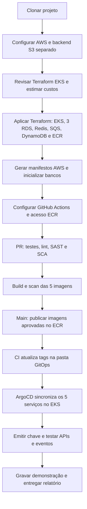

# ToggleMaster — Tech Challenge Fase 3

Cinco microsserviços de feature flags com infraestrutura AWS em Terraform, CI DevSecOps no GitHub Actions e entrega contínua por ArgoCD. Somente imagens aprovadas são publicadas no ECR com a tag do commit; o ArgoCD monitora os manifestos e sincroniza o EKS.

Os guias usam **PowerShell na máquina local**. O CMD não interpreta `$nome`, `Invoke-RestMethod` ou `ConvertTo-Json`. Não copie o prefixo do prompt (`fiap-tc-fase-03>`).

Comece na raiz deste repositório. Cada guia informa a pasta e os terminais necessários. Para manutenção, diagnóstico e encerramento, consulte [operação](OPERACAO.md) e [solução de problemas](SOLUCAO-DE-PROBLEMAS.md).

## 1. Provisionar

Siga [infrasctructure/eks/README.md](PROVISIONAMENTO.md). Use o estado `fase3/eks/terraform.tfstate`.

Os serviços no EKS usam credenciais temporárias por **EKS Pod Identity**. O GitHub Actions publica no ECR com access key de um usuário IAM exclusivo e restrito, configurada nos GitHub Secrets. Esse fluxo dispensa a criação de providers IAM OIDC na conta.

Revise o custo de EKS, nós, NAT Gateway, três RDS e ElastiCache antes do apply. Nunca misture estados de stacks diferentes.

## 2. Configurar e publicar

Siga [deploy/README.md](DEPLOY.md), na ordem:

1. Gere os manifestos com os outputs Terraform.
2. Inicialize bancos e Secrets.
3. Crie a access key do usuário IAM de publicação e configure os Secrets e Variables do GitHub.
4. Instale ArgoCD no EKS, publique em `main` e espere `publish` e `gitops` passarem antes de aplicar a Application. Confirme `Synced/Healthy` e Pods `Running`.
5. Emita `SERVICE_API_KEY` e teste o fluxo.

## 3. Entregar

Use o [roteiro de apresentação](ROTEIRO-APRESENTACAO.md) para gravar o vídeo de até 20 minutos e preencha o [relatório de entrega](ENTREGA-FASE-3.md). Os [requisitos oficiais](<POSTECH - Tech Challenge - Fase 3.pdf>) definem as evidências obrigatórias.

## Operação e desenvolvimento

O [guia de operação](OPERACAO.md) cobre verificação de saúde, publicação, rollback, credenciais, custos e encerramento. Não versione `.env`, access keys, Secrets, estados, planos ou outputs Terraform.

Para desenvolvimento, o [Compose](../docker-compose.yaml) usa PostgreSQL, Redis e LocalStack. Configure seu `.env` a partir de [`.env.example`](../.env.example) antes de executar `docker compose up -d --build`. Código, contratos de API e testes ficam em `apps-togglemaster/src/<servico>`; o workflow define os testes e gates de entrega.

## Arquivos

| Caminho | Uso |
| --- | --- |
| [infrasctructure/eks](../infrasctructure/eks/) | Cenário da Fase 3; conta pessoal |
| [.github/workflows/deploy.yml](../.github/workflows/deploy.yml) | Testes, lint, SAST/SCA, scan, ECR e atualização GitOps |
| [gitops-manifests/aws](../gitops-manifests/aws/) | Cinco serviços com RDS, ElastiCache e AWS reais |
| [gitops-manifests/argocd/application.yaml](../gitops-manifests/argocd/application.yaml) | Sync automático com prune e self-heal |
| [docker-compose.yaml](../docker-compose.yaml) | Desenvolvimento local |
| [scripts](../scripts/) | Configuração, bootstrap, emissão de chave e atualização de imagens |
| [docs/OPERACAO.md](OPERACAO.md) | Gestão do ambiente EKS e encerramento |
| [docs/ROTEIRO-APRESENTACAO.md](ROTEIRO-APRESENTACAO.md) | Demonstração e evidências da entrega |
