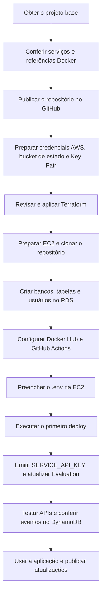

# ToggleMaster — configuração e deploy

Siga a ordem abaixo. Execute os comandos em Bash (Linux, macOS ou WSL); use SSH para os comandos indicados na EC2.

## 1. Preparar o repositório

1. Mantenha os cinco serviços em `apps-togglemaster/src/`.
2. Confira os caminhos nos arquivos abaixo ao mover ou substituir serviços.
3. Publique este repositório no GitHub, com a branch `main`.
4. Mantenha `.env`, chaves SSH, senhas e arquivos de estado fora do Git.

| Arquivo | Uso |
| --- | --- |
| [docker-compose.yaml](docker-compose.yaml) | Ambiente local: build, PostgreSQL, Redis e LocalStack |
| [deploy/compose.ec2.yaml](deploy/compose.ec2.yaml) | EC2: imagens Docker Hub, RDS e AWS reais |
| [deploy/nginx.conf](deploy/nginx.conf) | Rotas HTTP na porta 80 |
| [.github/workflows/deploy.yml](.github/workflows/deploy.yml) | Build, publicação de imagens e deploy |

## 2. Provisionar AWS e preparar os bancos

Execute as etapas 1–4 de [infrasctructure/README.md](infrasctructure/README.md).

Antes de continuar, confirme:

- [ ] Terraform aplicado e outputs anotados.
- [ ] SSH e Docker funcionando na EC2.
- [ ] Clone disponível em `~/<nome-do-repositorio>` na EC2, ou caminho definido pela variable `EC2_DEPLOY_DIR` no GitHub.
- [ ] `00-init.sql` e `01-users.sql` executados no RDS.
- [ ] Senhas de `auth_user`, `flags_user` e `targeting_user` disponíveis.

## 3. Configurar e executar o deploy

Execute as etapas 1–4 de [deploy/README.md](deploy/README.md):

1. Configure Docker Hub e GitHub Actions.
2. Preencha o `.env` na EC2 com [deploy/.env.ec2.example](deploy/.env.ec2.example).
3. Execute o workflow na branch `main`.
4. Emita a chave de serviço e atualize `SERVICE_API_KEY`.

## 4. Testar e usar

Execute os testes da etapa 5 de [deploy/README.md](deploy/README.md).

Use `http://<IP_EC2>/<prefixo>/<rota>`:

| Serviço | Exemplo |
| --- | --- |
| Auth | `/auth/validate` |
| Flags | `/flags/flags` |
| Targeting | `/targeting/rules/<flag>` |
| Evaluation | `/evaluation/evaluate?user_id=teste&flag_name=<flag>` |
| Analytics | `/analytics/health` |

## Consultas frequentes

| Tarefa | Onde seguir |
| --- | --- |
| Alterar infraestrutura | [Infraestrutura — manutenção](infrasctructure/README.md#manutenção) |
| Publicar código, alterar `.env` ou consultar logs | [Deploy — rotina](deploy/README.md#rotina) |
| Consultar APIs e execução individual | READMEs em `apps-togglemaster/src/<serviço>/` |
| Usar o cenário Kubernetes | [Manifestos Kubernetes](gitops-manifests/k8s-manifests/README.md) |
