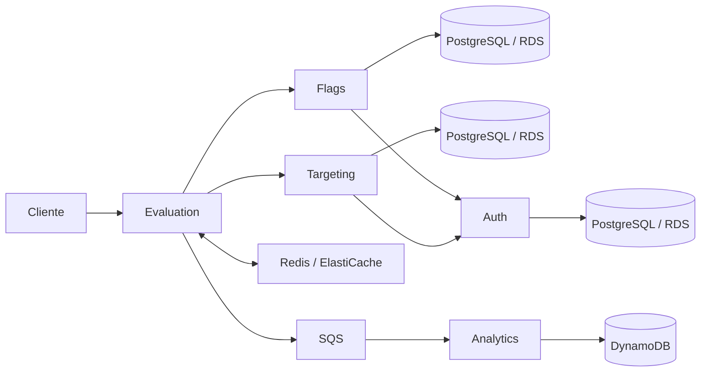

# ToggleMaster — Tech Challenge Fase 3

ToggleMaster é uma aplicação de feature flags: permite cadastrar funcionalidades, definir regras de liberação e consultar se uma funcionalidade está habilitada para determinado usuário. O projeto reúne cinco microsserviços, infraestrutura AWS em Terraform e um fluxo DevSecOps com GitHub Actions e ArgoCD.

## Arquitetura

| Serviço | Responsabilidade | Tecnologia e dados no ambiente AWS |
| --- | --- | --- |
| Auth | Emissão e validação de chaves de API | Go e PostgreSQL no RDS |
| Flags | Cadastro e consulta de feature flags | Python/Flask e PostgreSQL no RDS |
| Targeting | Regras de segmentação por flag | Python/Flask e PostgreSQL no RDS |
| Evaluation | Decisão de liberação por usuário e publicação de eventos | Go, Redis no ElastiCache e SQS |
| Analytics | Consumo dos eventos de avaliação e persistência para consulta | Python/Flask, SQS e DynamoDB |

Evaluation consulta Flags e Targeting, mantém os dados em cache no Redis e calcula a decisão para o usuário. Os eventos de avaliação seguem pela fila SQS até Analytics, que os grava no DynamoDB. Auth fornece as chaves usadas nas chamadas autenticadas entre os serviços.

No ambiente AWS, os serviços rodam no EKS. Evaluation e Analytics recebem credenciais temporárias por EKS Pod Identity. O GitHub Actions executa testes, lint, análise de código e dependências e scan das imagens. Após a aprovação em `main`, publica no ECR as imagens com a tag do commit e atualiza os manifestos no Git. O ArgoCD acompanha esses manifestos e sincroniza o cluster.

O Docker Compose oferece um ambiente de desenvolvimento com PostgreSQL, Redis e LocalStack, que simula SQS e DynamoDB. Esse ambiente permite explorar a aplicação localmente; a reprodução da infraestrutura e do fluxo GitOps usa AWS e GitHub.

## Como seguir a documentação

Para clonar e testar o projeto, use uma máquina local e siga os passos em **`docs/`**. Os prefixos numéricos indicam a ordem de leitura e execução para reproduzir o ambiente AWS: **01 → 02 → 03**. Cada guia informa os pré-requisitos, a pasta de execução, os comandos e como conferir o resultado.

| Ordem | Documento | O que você encontra |
| --- | --- | --- |
| 01 | [Provisionamento](docs/01-PROVISIONAMENTO.md) | Preparação da máquina, fork e clonagem, configuração da conta AWS e do estado Terraform, criação da infraestrutura e conexão ao EKS. |
| 02 | [Deploy](docs/02-DEPLOY.md) | Configuração dos manifestos, inicialização dos bancos, credenciais do pipeline, instalação do ArgoCD, publicação dos serviços e testes de APIs e eventos. Depende do guia 01. |
| 03 | [Operação](docs/03-OPERACAO.md) | Verificação do ambiente, publicação e reversão de versões, manutenção de credenciais, custos e encerramento dos recursos. Inclui uma seção independente para desenvolvimento local com Compose. |
| Consulta | [Solução de problemas](docs/SOLUCAO-DE-PROBLEMAS.md) | Diagnóstico de acesso ao cluster, provisionamento, credenciais, imagens, scans e testes HTTP. Consulte quando uma etapa falhar. |

Se seu objetivo for somente executar a aplicação localmente, faça a preparação e a clonagem descritas no início do guia 01 e siga a seção [Desenvolvimento local](docs/03-OPERACAO.md#desenvolvimento-local) do guia 03. Esse caminho dispensa o provisionamento AWS e o deploy no EKS.

## Onde encontrar cada parte

| Caminho | Conteúdo |
| --- | --- |
| [apps-togglemaster/src](apps-togglemaster/src/) | Código dos cinco serviços, handlers das APIs, testes, Dockerfiles e schemas SQL. |
| [infrasctructure/eks](infrasctructure/eks/) | Terraform do ambiente AWS, exemplos de variáveis e backend, outputs e testes da infraestrutura. |
| [.github/workflows/deploy.yml](.github/workflows/deploy.yml) | Validações do CI, verificações de segurança, publicação no ECR e atualização das tags no GitOps. |
| [gitops-manifests/aws](gitops-manifests/aws/) | Manifestos Kubernetes e Kustomization dos cinco serviços. |
| [gitops-manifests/argocd/application.yaml](gitops-manifests/argocd/application.yaml) | Origem Git e política de sincronização da aplicação no ArgoCD. |
| [scripts](scripts/) | Automação dos manifestos AWS, bootstrap dos bancos, emissão de chave e atualização de imagens. |
| [deploy](deploy/) | SQL e recursos auxiliares para inicialização dos bancos no Compose e no EKS. |
| [docker-compose.yaml](docker-compose.yaml) e [.env.example](.env.example) | Definição do ambiente local e exemplo das suas configurações. |
| [docs](docs/) | Guias de reprodução, operação e diagnóstico do projeto. |
