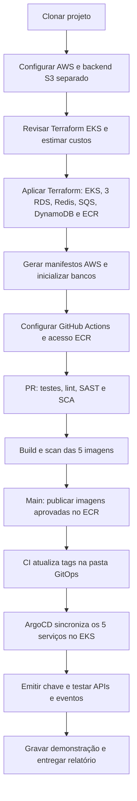

# ToggleMaster — Tech Challenge Fase 3

Execute os comandos em Bash. Para o CMD/PowerShell, adapte a sintaxe ou use WSL.

## 1. Provisionar

Siga [infrasctructure/eks/README.md](infrasctructure/eks/README.md). Use o estado `fase3/eks/terraform.tfstate`.

Os serviços no EKS usam credenciais temporárias por **EKS Pod Identity**. O GitHub Actions publica no ECR com access key de um usuário IAM exclusivo e restrito, configurada nos GitHub Secrets. Esse fluxo dispensa a criação de providers IAM OIDC na conta.

Não aplique o novo cenário no estado da EC2. Revise o custo de EKS, NAT Gateway, três RDS e ElastiCache antes do apply.

## 2. Configurar e publicar

Siga [deploy/README.md](deploy/README.md), na ordem:

1. Gere os manifestos com os outputs Terraform.
2. Inicialize bancos e Secrets.
3. Configure AWS/GitHub e instale ArgoCD.
4. Publique em `main` e acompanhe o CI e o ArgoCD.
5. Emita `SERVICE_API_KEY` e teste o fluxo.

## 3. Entregar

Preencha [docs/ENTREGA-FASE-3.md](docs/ENTREGA-FASE-3.md). Grave vídeo de até 20 minutos com IaC, bloqueio de segurança e sincronização GitOps.

## Retomar e encerrar

Siga [docs/RETOMADA.md](docs/RETOMADA.md) para continuar amanhã e remover os ambientes.

## Arquivos

| Caminho | Uso |
| --- | --- |
| [infrasctructure/eks](infrasctructure/eks/) | Cenário da Fase 3; conta pessoal |
| [.github/workflows/deploy.yml](.github/workflows/deploy.yml) | Testes, lint, SAST/SCA, scan, ECR e atualização GitOps |
| [gitops-manifests/aws](gitops-manifests/aws/) | Cinco serviços com RDS, ElastiCache e AWS reais |
| [gitops-manifests/argocd/application.yaml](gitops-manifests/argocd/application.yaml) | Sync automático com prune e self-heal |
| [docker-compose.yaml](docker-compose.yaml) | Desenvolvimento local |
| [gitops-manifests/k8s-manifests](gitops-manifests/k8s-manifests/) | Kubernetes local com LocalStack |
| [infrasctructure/README.md](infrasctructure/README.md) | Infraestrutura EC2 anterior |
| [deploy/legacy/README.md](deploy/legacy/README.md) | Deploy manual alternativo na EC2 |
